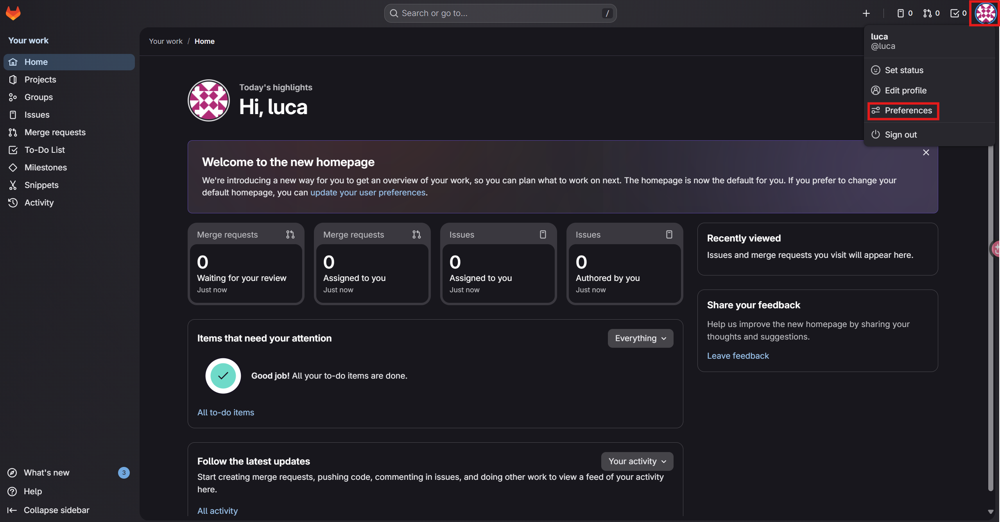
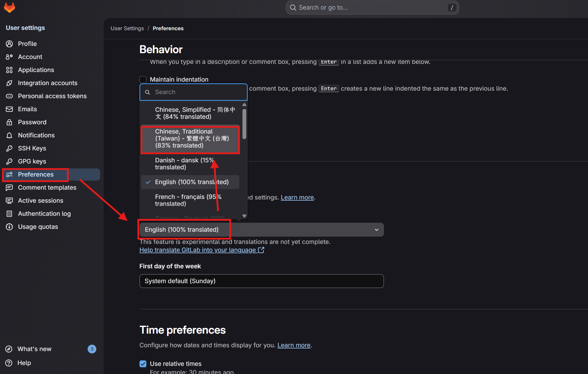
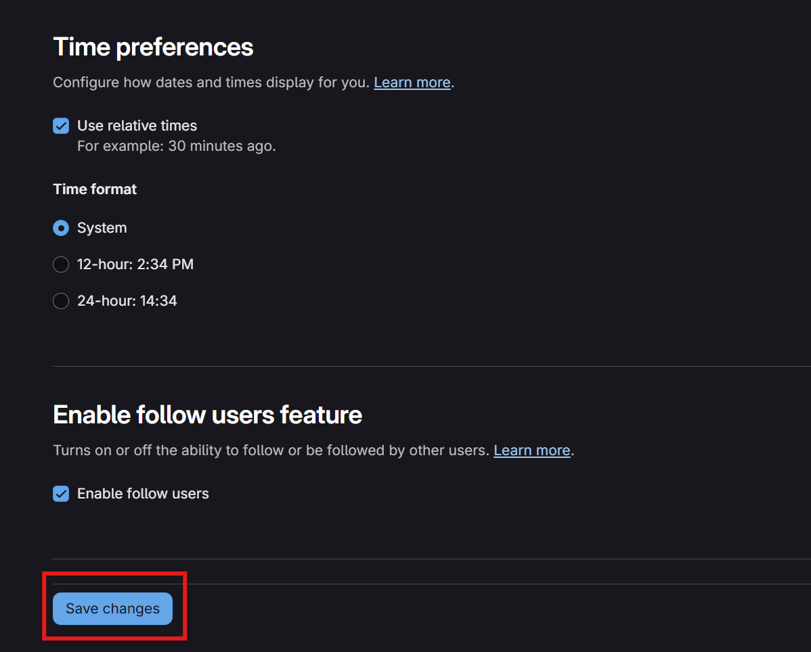

# 初次使用設定

## 語言設定

將 GitLab 介面語言從預設的 English 切換為繁體中文。

### 步驟

1. 登入 GitLab 後，點擊畫面**右上角的使用者頭像**，在展開的下拉選單中選擇 **Preferences（偏好設定）**。

2. 進入 Preferences 頁面後，找到 **Language** 區塊，點擊語言下拉選單（預設為 `English (100% translated)`），從清單中選擇 **`Chinese, Traditional (Taiwan) - 繁體中文 (83% translated)`**。

3. 將頁面捲動至最下方，點擊藍色的 **Save changes（儲存變更）** 按鈕以套用設定。

4. 儲存完成後，**重新整理瀏覽器頁面（F5）**，介面即會切換為繁體中文。

> 💡 **提示**：因繁體中文翻譯完成度為 83%，部分介面文字可能仍顯示為英文，此為正常現象。
