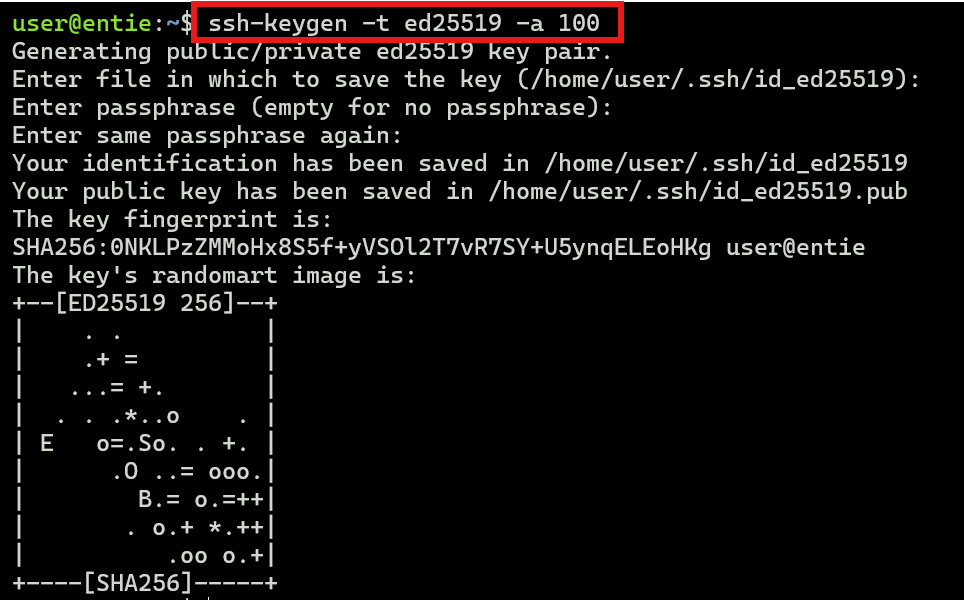
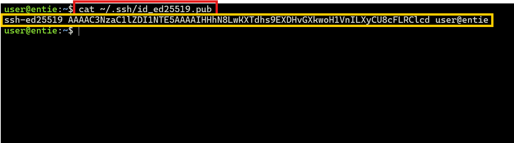
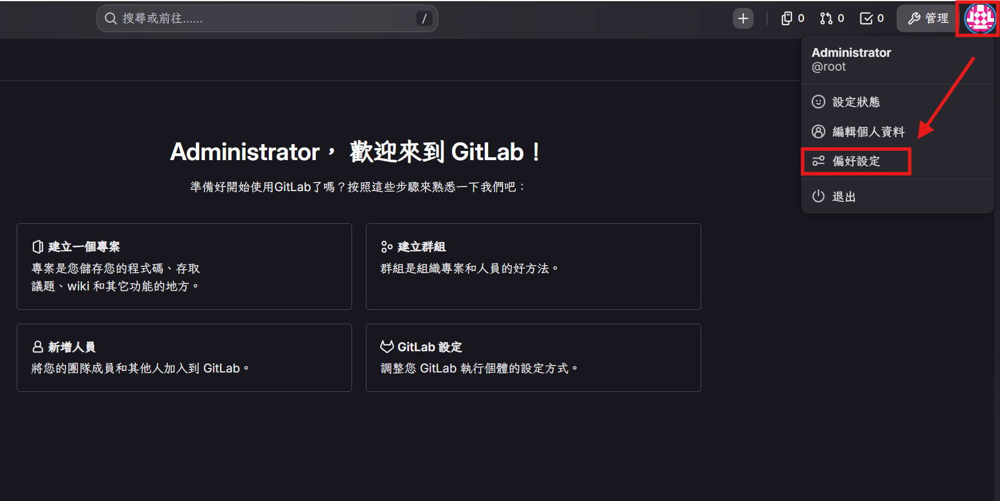
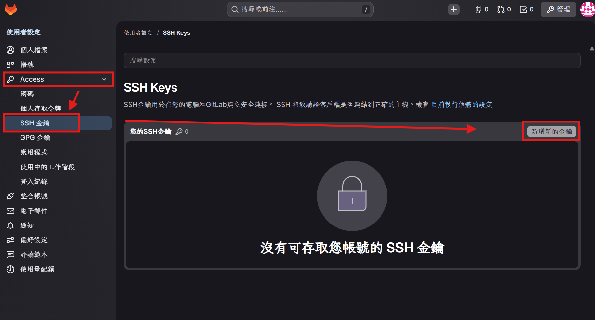
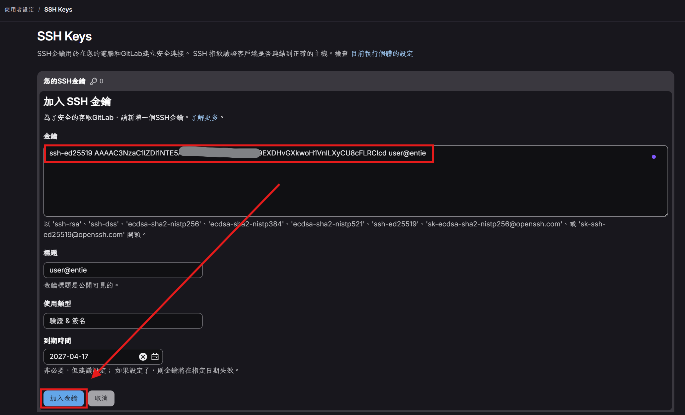

# 設定 SSH 金鑰

透過 SSH 金鑰連線 GitLab，可避免每次 push / pull 都需要輸入帳號密碼，同時提升傳輸安全性。

---

## 一、生成 SSH 金鑰（本機端操作）

1. 開啟終端機，輸入以下指令產生 **Ed25519** 金鑰：

    ```bash
    ssh-keygen -t ed25519 -a 100
    ```

    執行後會依序詢問：
    - **儲存路徑**（`Enter file in which to save the key`）：直接按 <kbd>Enter</kbd> 使用預設路徑 `~/.ssh/id_ed25519`。
    - **通行碼**（`Enter passphrase`）：可留空直接按 <kbd>Enter</kbd>，或自行設定密碼加強保護。
    - **再次確認通行碼**：輸入同樣內容後按 <kbd>Enter</kbd>。

    完成後會顯示金鑰指紋（SHA256）與隨機圖案（randomart），代表金鑰生成成功。



2. 使用 `cat` 指令讀取**公鑰**內容，並完整複製（從 `ssh-ed25519` 開頭到結尾的使用者名稱）：

    ```bash
    cat ~/.ssh/id_ed25519.pub
    ```

    > ⚠️ **注意**：只能複製 `.pub` 結尾的**公鑰**檔案；`id_ed25519`（無副檔名）為**私鑰**，絕對不可外流或貼到 GitLab。



---

## 二、將金鑰加入 GitLab

1. 登入 GitLab，點擊**右上角頭像**，於下拉選單中選擇 **偏好設定**。



2. 在左側選單展開 **Access** 分類，點擊 **SSH 金鑰**，接著點擊右上角的 **新增新的金鑰** 按鈕。



3. 在新增金鑰頁面填寫以下資訊：

    | 欄位 | 說明 |
    | --- | --- |
    | **金鑰** | 貼上剛才複製的公鑰內容（`ssh-ed25519 AAAA...` 整串） |
    | **標題** | 會自動帶入金鑰尾端的使用者名稱，可自行修改方便辨識（如：公司筆電） |
    | **使用類型** | 預設 **驗證 & 簽名** 即可 |
    | **到期時間** | 預設一年後到期，可依需求調整或留空 |

    填寫完畢後點擊左下角的 **加入金鑰** 按鈕完成設定。



---

## 三、驗證連線（選用）

回到終端機，執行以下指令測試 SSH 連線是否成功：

```bash
ssh -T git@<你的 GitLab 網域>
```

若看到歡迎訊息（例如 `Welcome to GitLab, @username!`），即代表 SSH 金鑰設定完成。
