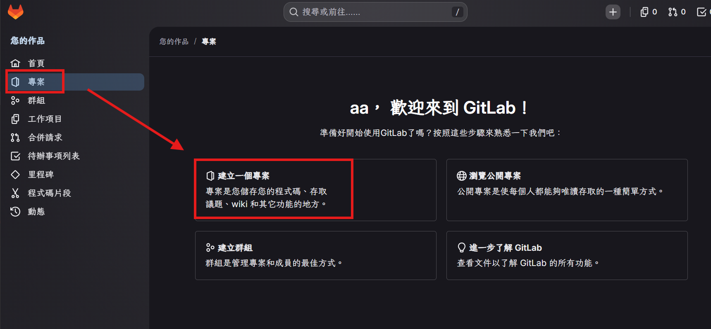
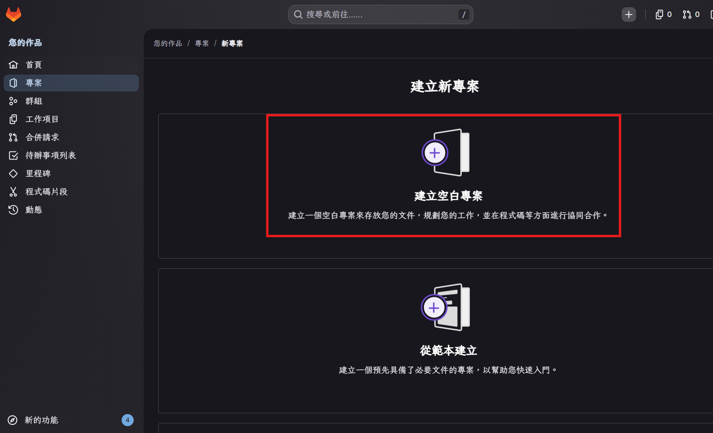
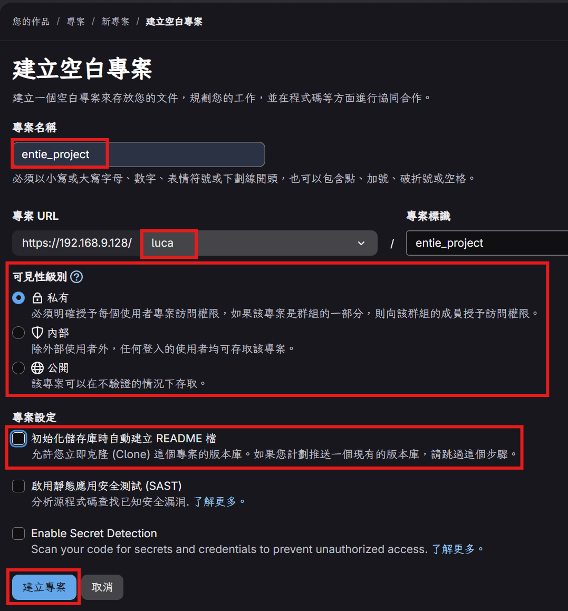
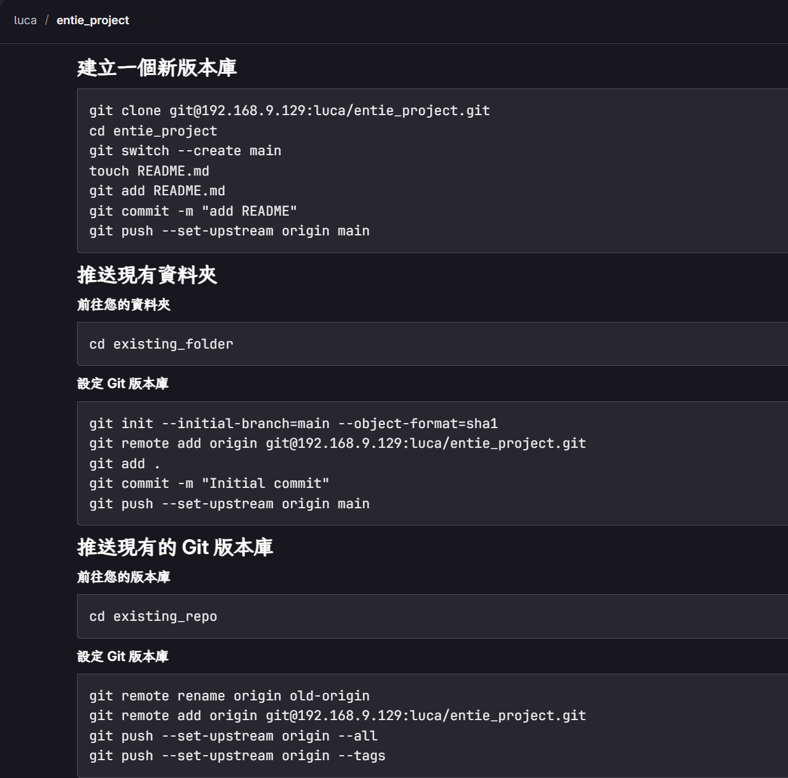

# 建立專案

在 GitLab 上建立一個新的程式碼儲存庫（Repository），用來存放專案檔案、協同開發與版本控管。

---

## 一、建立新專案

1. 進入 GitLab 後，左側選單點擊 **專案**，接著在主畫面選擇 **建立一個專案**。



2. 在「建立新專案」頁面中，選擇 **建立空白專案**。

    > 💡 若已有現成範本需求，也可選擇「從範本建立」快速帶入常用檔案結構。



---

## 二、填寫專案資訊

依下表填寫欄位：

| 欄位 | 說明 |
| --- | --- |
| **專案名稱** | 輸入專案名稱（例：`entie_project`），系統會自動帶入 **專案 URL** 中的 slug。 |
| **專案 URL** | 確認網址路徑正確，格式為 `https://<伺服器位址>/<使用者或群組>/<專案名稱>`。 |
| **可見性層級** | 依需求選擇：**私有**（僅成員）、**內部**（登入者可見）、**公開**（所有人可見）。 |
| **初始化儲存庫時自動建立 README 檔** | **建議不要勾選**；若勾選則遠端會先產生一次 commit，後續從本機 push 時需先 pull 合併，較為麻煩。 |

填寫完成後，點擊左下角 **建立專案** 按鈕。



---

## 三、推送程式碼到專案

建立完成後，GitLab 會顯示三種常見情境的 Git 指令，依本機專案狀態選擇對應區塊逐行執行即可。



### 情境 1：建立一個全新的版本庫

尚未有任何本機檔案，直接從 GitLab clone 空專案後開始開發：

```bash
git clone git@192.168.9.129:luca/entie_project.git
cd entie_project
git switch --create main
touch README.md
git add README.md
git commit -m "add README"
git push --set-upstream origin main
```

### 情境 2：推送現有資料夾（尚未 git init）

本機已有專案資料夾，但尚未納入 Git 版控：

```bash
cd existing_folder
git init --initial-branch=main --object-format=sha1
git remote add origin git@192.168.9.129:luca/entie_project.git
git add .
git commit -m "Initial commit"
git push --set-upstream origin main
```

### 情境 3：推送現有的 Git 版本庫

本機已是 Git 專案，只需更換遠端位置：

```bash
cd existing_repo
git remote rename origin old-origin
git remote add origin git@192.168.9.129:luca/entie_project.git
git push --set-upstream origin --all
git push --set-upstream origin --tags
```

> ⚠️ **提醒**：以上指令中的 `192.168.9.129` 與 `luca/entie_project.git` 會依你自己的 GitLab 伺服器與帳號自動帶入，請**直接複製 GitLab 頁面顯示的指令**，不要照抄本文件範例。
